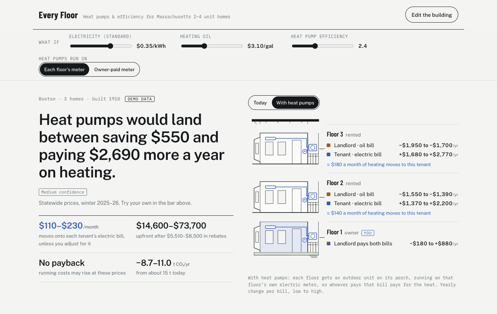

# Every Floor

**Heat pumps and efficiency programs for Massachusetts triple-deckers and two-families: which programs fit each floor, what to do first, and who saves or pays more when a building switches.**

[](https://github.com/Qiao527/ma-energy-navigator/actions/workflows/ci.yml)

**Live page:** https://qiao527.github.io/ma-energy-navigator/



*The building shown is the demo: **demo data**, with fictional oil delivery records.*

An energy engineering portfolio project by **Qiao Long** (Boston College, Human-Centered Engineering).

---

## Why it exists

Massachusetts has generous efficiency and heat pump programs, but they are hard to navigate. A small landlord
deciding about a 2–4 unit building faces three problems:

- **Many rules.** Programs change by unit, owner, income, town and install date.
- **Split bills.** The landlord often buys the oil, while tenants pay the electric bill a heat pump runs on.
- **Few navigators.** MassCEC's human navigator service is a pilot in six cities.

Households below 200% of the federal poverty level spend about 13% of income on home energy, against about 2% for
everyone else (DOE LEAD Tool, 2022 update).

The project started from a hackathon brief on Massachusetts buildings: energy waste, retrofit prioritization,
building performance, tenant and owner incentives, and access to energy savings. The hackathon has ended; this
repository finishes the idea.

## What it shows

For a confirmed building (who lives on each floor, the heating fuel, who pays which bill), the page shows:

1. **The answer.** The yearly change in the building's heating cost with heat pumps, as a range with a
   confidence label, beside the building drawn floor by floor. Each floor shows each bill and who pays it.
2. **Why.** What one million Btu of heat costs from oil, gas, propane, electric baseboard and a cold-climate heat
   pump, plus the electricity price and heat pump efficiency at which a heat pump breaks even.
3. **What-if controls.** Your own electricity price, fuel price and heat pump efficiency, and whether the heat
   pumps run on the tenants' meters or an owner-paid meter. Every number on the page follows.
4. **Fairness.** Heating cost that would move onto tenants' electric bills, the Massachusetts sanitary code
   constraint (105 CMR 410), and four fair ways to handle it. This is not legal advice.
5. **Access.** A map of Designated Equity Communities and the MassCEC navigator pilot cities.
6. **The plan.** Programs in the order to do them, what each requires, and what only the program can confirm.
7. **The method.** Every step from fuel records to bills and CO₂, with every assumption's source.

### An honest finding

At Massachusetts statewide prices for winter 2025–26, the demo building's switch from oil to heat pumps is
**about break-even at best and more expensive in the typical case**: from saving about $550 to paying about
$2,690 more a year.

- One million Btu of heat costs about $27 from an 84% oil boiler.
- From a heat pump at the field-measured seasonal efficiency of 2.41, it costs about $33 on Eversource's winter
  heat pump rate ($0.27/kWh instead of $0.35/kWh standard).

The page says so plainly and shows where the break-even point lies: about $0.22/kWh at today's efficiency, or a
seasonal efficiency of about 3.0 at the winter heat pump rate. This matches the Department of Energy Resources'
own caution that households "should not assume that switching fuels will automatically lead to savings."

## The energy chain

| Step | How | Source |
|---|---|---|
| Fuel use | The user's delivery records, by heating season | User input |
| Weather normalization | Each season × normal ÷ actual heating degree days | NOAA CPC, Massachusetts population-weighted HDD |
| Hot water | When the boiler also heats water, the typical hot-water share is removed | NREL ResStock 2025.1, MA 2–4 unit homes (oil 18%, gas 21%) |
| Heat delivered | Fuel × heat content × boiler efficiency | EIA heat contents; EEAC baseline AFUE |
| No records | Typical heat load and heat pump size for similar buildings | ResStock, by fuel and vintage (25th / 50th / 75th percentile) |
| Heat pump electricity | Heat ÷ seasonal COP (1.90 / 2.41 / 2.80) | Cadmus cold-climate heat pump field study (MassCEC, NYSERDA, DOE) |
| Bills | Statewide prices for this winter and last | Massachusetts DOER, Household Heating Costs |
| Heat pump rate | Winter (Nov–Apr) delivery discount by electric company | Eversource and National Grid tariffs; D.P.U. 26-71 |
| CO₂ | Fuel factors; New England grid factor | EPA Emission Factors Hub 2025 (eGRID NEWE) |
| Project cost | Tons × installed cost per ton | EEAC Residential Heat Pump Invoice Cost Study |
| Incentives | Each program's published rules, with verbatim quotes | Mass Save, mass.gov, DPU, M.G.L. |

All 49 assumptions and every rule are listed in the page, with links and the date each was checked.

## How the numbers stay honest

- **Numbers come only from tested code.** The engine (`engine/`) computes eligibility, costs, bills, payback and
  CO₂ as low / mid / high ranges with a confidence label and its reasons. Nothing is typed by hand into the page.
- **Every rule and assumption has a source.** Each one carries a URL, the section, a verbatim quote and the date
  it was checked.
- **Quotes are machine-checked.** `npm run rules:check-drafts` verifies every quote against a saved text snapshot
  of the source (`rules/ma/sources/`).
- **Nothing ships without the owner's approval.** An approval is recorded in `rules/ma/approvals.json` against
  the file's SHA-256. The loader refuses any rule file that changed after approval, and the web build fails too.
- **Standard scenarios.** `npm run scenarios` runs fixed buildings and dates against expected results; a changed
  result needs the owner's approval.
- **Ask, don't guess.** Unknown facts (who pays a bill, whether the boiler heats water) become questions, never
  assumptions.

Decisions and their reasons are logged in [`docs/decisions.md`](docs/decisions.md); the product definition is in
[`docs/product.md`](docs/product.md); the working rules are in [`CONTRIBUTING.md`](CONTRIBUTING.md).

## Repository

```
engine/     TypeScript rules engine and finance core (Zod, Vitest, fast-check): 217 tests
rules/ma/   Approved rules and assumptions, source snapshots, approval ledger
scenarios/  Standard scenarios with expected results
web/        The page: a static build that runs the engine in the browser (esbuild)
analysis/   Python (standard library) data scripts: ResStock estimates, town boundaries
tools/      Source capture, draft report, approval
docs/       Product definition, decisions, research, plans
```

## Run it

Requires Node 24 and Python 3.

```bash
cd engine && npm ci && npm run check          # typecheck + all tests
npm run scenarios                             # standard scenarios
cd ../web && npm ci && npm run build          # web/dist/index.html (approved rules only)
python3 -m pytest analysis tools              # data script tests
```

Open `web/dist/index.html` in a browser. Nothing you enter leaves the browser.

## Accessibility

The target is WCAG 2.2 AA:

- every chart has a table;
- color never carries meaning alone;
- all controls work by keyboard;
- motion stops under `prefers-reduced-motion`;
- the page works at phone width (checked at 360 px).

Automated axe-core scans (WCAG 2.0–2.2 A/AA) report no violations in light or dark mode.

## Data and credits

- **NREL ResStock 2025 Release 1.** Licensed CC BY 4.0: "End-Use Load Profiles for the U.S. Building Stock",
  National Renewable Energy Laboratory.
- **U.S. Census Bureau** cartographic boundaries; **NOAA** Climate Prediction Center degree days; **EPA**
  Emission Factors Hub; **EIA** heat contents. All are U.S. government works.
- **Program rules** are quoted from Mass Save, mass.gov (DOER, DPU, the 105 CMR 410 sanitary
  code) and the Massachusetts General Laws, with the link to each source.

Programs decide eligibility. This tool shows what their published rules say and names what to confirm.

## License

Code: [MIT](LICENSE), © 2026 Qiao Long. Data and quoted program text keep their own terms (see Data and credits):
ResStock is CC BY 4.0, and U.S. government works are in the public domain.

## Author

Qiao Long · [github.com/Qiao527](https://github.com/Qiao527)
