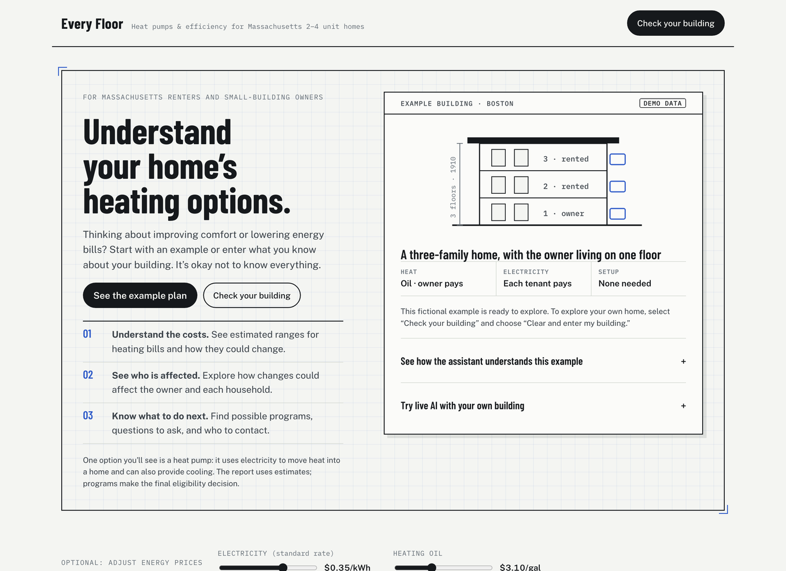
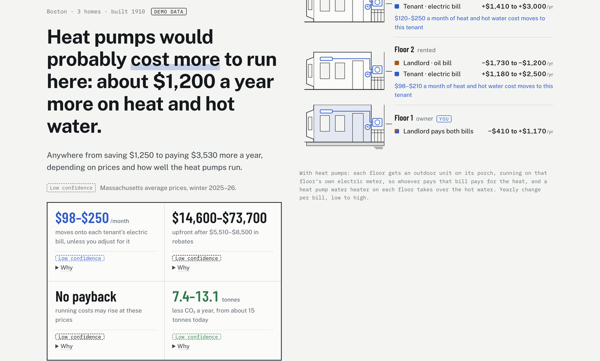
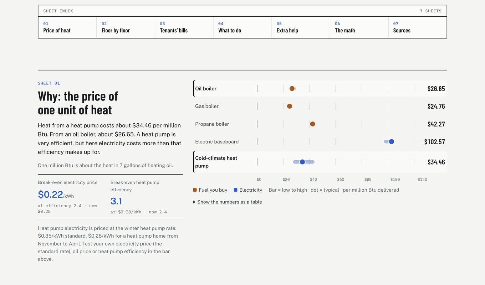
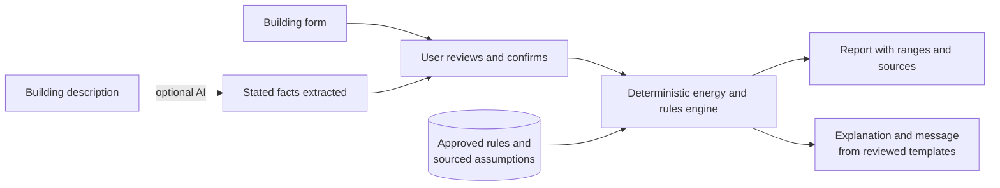

<div align="center">

# Every Floor

**An energy navigator for Massachusetts 2–4 unit homes.**<br>
See what heat pumps would cost to run, who would pay which bill, and which programs to try first, floor by floor.

[](https://github.com/Qiao527/ma-energy-navigator/actions/workflows/ci.yml)


[](LICENSE)

**[Open the live demo →](https://every-floor.vercel.app/)**

[How it works](#how-it-works) · [Methods](docs/methods.md) · [AI evaluation](eval/README.md) · [Run it locally](#run-it-locally) · [All docs](docs/README.md)

</div>

<picture>
  <source media="(prefers-color-scheme: dark)" srcset="docs/assets/every-floor-home-dark.png">
  
</picture>

<sub>The demo building is fictional, including its oil delivery records. Estimates are not quotes or eligibility decisions.</sub>

---

## At a glance

| | |
|---|---|
| **Who it's for** | Renters and small-building owners in Massachusetts 2–4 unit homes (triple-deckers, two-families) |
| **What it answers** | Would heat pumps cost more or less to run here? Whose bill changes, and by how much? What should we do first? |
| **How** | A tested, deterministic TypeScript engine computes every number as a low / typical / high range from sourced assumptions |
| **Where AI fits** | Optional. It reads a short description into form fields for you to confirm. It never calculates a number or names a program |
| **Privacy** | Form calculations run in your browser. Only text sent to the optional AI assistant leaves the page |

An energy engineering portfolio project by Qiao Long (Boston College, Human-Centered Engineering).

## Contents

- [Why it exists](#why-it-exists)
- [What the report shows](#what-the-report-shows)
- [How it works](#how-it-works)
- [How the numbers stay honest](#how-the-numbers-stay-honest)
- [The energy chain](#the-energy-chain)
- [Repository layout](#repository-layout)
- [Run it locally](#run-it-locally)
- [Accessibility](#accessibility)
- [Status and limitations](#status-and-limitations)
- [Data, credits and license](#data-credits-and-license)

## Why it exists

Heating upgrades in small rental buildings involve more than choosing equipment. The owner may pay for fuel and
the upgrade, while tenants pay the electric bills that could change. Program requirements also depend on the
building and on each household.

> Households below 200% of the federal poverty level spend about **13%** of their income on home energy.
> For everyone else it's about **2%**. *DOE LEAD Tool, 2022 update*

[MassCEC's Home Modernization Navigator](https://goclean.masscec.com/home-modernization-navigator/) provides human
help in participating cities. This project explores how software can make the first steps easier to understand.
The idea came from a hackathon brief on Massachusetts buildings: energy waste, retrofit priorities, and who gets
access to savings. The hackathon is over; this repository finishes the idea.

## What the report shows

You describe the building: who lives on each floor, how it's heated, who pays which bill. The report is laid out
like a drawing set. It opens with the answer beside the building drawn floor by floor, then numbered sheets:

<picture>
  <source media="(prefers-color-scheme: dark)" srcset="docs/assets/every-floor-dark.png">
  
</picture>

| | Sheet | What you get |
|---|---|---|
| ★ | **The answer** | The likely yearly change in running cost as a range, the cost moved to each tenant, upfront cost after rebates, payback and CO₂, beside the building drawn floor by floor with each bill and who pays it |
| 01 | **Price of heat** | What one million Btu costs from oil, gas, propane, baseboard and a heat pump, and the electricity price and efficiency at which a heat pump breaks even |
| 02 | **Floor by floor** | Each floor's yearly heating bill today and with heat pumps |
| 03 | **Tenants' bills** | The heating cost that would move onto tenants' bills, the sanitary code rule that limits it (105 CMR 410), and four fair ways to handle it. Not legal advice |
| 04 | **What to do** | The programs in the order to do them, what each one needs, and what only the program can confirm |
| 05 | **Extra help** | A map of Designated Equity Communities and the navigator pilot cities |
| 06–07 | **The math and sources** | Every step of the calculation, with a source and check date for every assumption |

A bar at the top lets you try your own electricity price, fuel price and heat pump efficiency, and switch the heat
pumps between tenants' meters and an owner-paid meter. Every number on the page follows.

<picture>
  <source media="(prefers-color-scheme: dark)" srcset="docs/assets/every-floor-charts-dark.png">
  
</picture>

### What the example shows

The fictional Boston building illustrates why electrification cannot be reduced to a guaranteed savings number.
The result depends on fuel prices, electricity rates, equipment efficiency and the available records, so the
report shows ranges and lets you explore how assumptions move the result.

It also makes the **split incentive** visible: when an owner pays for oil and tenants pay their own electricity,
replacing oil heat can move costs between people. The report names missing information instead of treating an
unknown payer as a zero cost shift. The [worked example](docs/methods.md) has the assumptions and sources.

## How it works



The model helps interpret a short description and chooses the focus and tone of a response. **It does not
calculate savings or write program names and figures.** Those come from the engine; explanations and coordination
messages are assembled from reviewed text. This is a constrained assistant, not an open-ended agent.

- Users confirm the extracted facts before they replace the form. Unknown fields stay unknown.
- The [AI evaluation](eval/README.md) covers 16 fictional cases: unknown facts, conflicting answers, per-floor
  differences, out-of-scope buildings and an instruction-injection attempt. One expanded run first misclassified a
  single-family owner; after a prompt change, the same 16 cases passed once. It is a small, developer-authored
  set, not a guarantee of model accuracy.

## How the numbers stay honest

| Guarantee | How it's enforced |
|---|---|
| **Numbers come only from tested code** | Estimates and eligibility come from the engine in `engine/` (Zod, Vitest, fast-check property tests) |
| **Ranges, not false precision** | Every estimate is low / mid / high with a confidence label and its reasons |
| **Every rule has a source** | Each rule and assumption carries its URL, section, a word-for-word quote and the date it was checked. `npm run rules:check-drafts` fails the build if a quote is missing from the saved source copy in `rules/ma/sources/` |
| **Nothing ships unapproved** | Approvals live in `rules/ma/approvals.json` against each file's SHA-256. The loader and the public build refuse any file changed after approval |
| **Answers don't drift** | Standard scenarios (`npm run scenarios`) pin the engine's answers for fixed buildings and dates. A changed answer needs approval again |
| **Ask, don't guess** | When a fact is unknown, like who pays a bill or whether the boiler heats the water, the page asks |

Decisions and their reasons are logged in [`docs/decisions.md`](docs/decisions.md); the working rules are in
[`CONTRIBUTING.md`](CONTRIBUTING.md).

## The energy chain

<details>
<summary><b>From delivery records to bills and CO₂: twelve steps, each with its source</b></summary>

<br>

| Step | How | Source |
|---|---|---|
| Fuel use | The user's delivery records, by heating season | User input |
| Weather normalization | Each season × normal ÷ actual heating degree days | NOAA CPC, Massachusetts population-weighted HDD |
| Hot water | When the boiler also heats water, the typical hot-water share is removed | NREL ResStock 2025.1, MA 2–4 unit homes (oil 18%, gas 21%) |
| Heat delivered | Fuel × heat content × boiler efficiency | EIA heat contents; EEAC baseline AFUE |
| No records | Typical heat load and heat pump size for similar buildings | ResStock, by fuel and vintage (25th / 50th / 75th percentile) |
| Heat pump electricity | Heat ÷ seasonal COP (1.90 / 2.41 / 2.80) | Cadmus cold-climate heat pump field study (MassCEC, NYSERDA, DOE) |
| Bills | Statewide prices for this winter and last | Massachusetts DOER, Household Heating Costs |
| Heat pump rate | Winter (Nov–Apr) delivery discount by electric company, weighted by the share of the heating season in those months | Eversource and National Grid tariffs; D.P.U. 26-71; NOAA CPC monthly HDD |
| Hot water switch | Oil for hot water out; a heat pump water heater's yearly electricity in | ResStock hot-water share; Efficiency Maine HPWH metering study (2026) |
| CO₂ | Fuel factors; New England grid factor | EPA Emission Factors Hub 2025 (eGRID NEWE) |
| Project cost | Tons × installed cost per ton | EEAC Residential Heat Pump Invoice Cost Study |
| Incentives | Each program's published rules, with verbatim quotes | Mass Save, mass.gov, DPU, M.G.L. |

All 51 assumptions and every rule are listed in the page, with links and the date each was checked. The full
worked example is in [`docs/methods.md`](docs/methods.md).

</details>

## Repository layout

```
engine/     TypeScript rules engine and finance core (Zod, Vitest, fast-check)
rules/ma/   Approved rules and assumptions, source snapshots, approval ledger
scenarios/  Standard scenarios with expected results
web/        The page: a static build that runs the engine in the browser (esbuild)
ai/         Server-side model integration, validation and tests
api/        Serverless entry points for the hosted AI service
eval/       Fictional model evaluation cases and reproducible runner
analysis/   Python (standard library) data scripts: ResStock estimates, town boundaries
data/       Shared Census municipality boundaries used by the engine and map
tools/      Source capture, draft report, approval
docs/       Product definition, methods, decisions, research, reviews (see docs/README.md)
```

| Layer | Stack |
|---|---|
| Engine | TypeScript, Zod schemas, Vitest, fast-check property tests |
| Page | Static HTML + TypeScript bundled with esbuild; hand-drawn SVG, no chart library |
| AI service | Node 24, DeepSeek JSON output, server-side validation |
| Data scripts | Python 3 standard library, pytest |
| Delivery | GitHub Actions CI, GitHub Pages (static), Vercel (with AI) |

## Run it locally

Requires Node 24 and Python 3.

```bash
cd engine && npm ci && npm run check          # typecheck + all tests
npm run scenarios                             # standard scenarios
cd ../web && npm ci && npm run build          # web/dist/index.html (approved rules only)
cd .. && python3 -m pytest analysis tools     # data script tests
```

Open `web/dist/index.html` in a browser. Form calculations run in the browser.

<details>
<summary><b>Optional: the AI navigator on a local server</b></summary>

<br>

The assistant extracts explicitly stated facts from a description; you review and confirm them before they replace
the form. It can also choose the focus and tone of a short explanation and a coordination message. Those texts use
fixed, reviewed sentences and the current engine result: the model cannot write the displayed amounts or program
names.

Live AI requires the visitor's own DeepSeek API key and is billed to their account. The key stays in the page's
password field until reload and is sent via HTTPS to the application server, which forwards it to DeepSeek for
each request. The app does not persist or log it. The GitHub Pages demo is static and cannot run the AI service.

Build the page as above, then run:

```bash
node ai/server.mjs
```

Open `http://localhost:3000` and enter your key in the page. The local server does not log requests and is for
local testing only, not public deployment. `DEEPSEEK_MODEL` optionally overrides the default model. Calls use the
[DeepSeek JSON output](https://api-docs.deepseek.com/guides/json_mode/).

Using the assistant sends the text you enter to DeepSeek; do not include names, street addresses, account numbers
or utility bills. The public backend has a per-IP rate limit, which is not an account-wide spending cap.

Run `node --test ai/*.test.mjs` for service validation tests. The engine suite covers the confirmation and
rendering boundary and grounding across the standard scenarios. These tests use mocked model responses and cannot
establish the model's extraction accuracy.

</details>

## Accessibility

The target is WCAG 2.2 AA:

- every chart has a table;
- color never carries meaning alone;
- keyboard access and visible focus are design requirements;
- motion stops under `prefers-reduced-motion`;
- the page works at phone width (checked at 360 px).

## Status and limitations

What has and hasn't been verified, in one place:

- **Accessibility.** The Phase 1 release recorded automated axe-core scans with no violations in light or dark
  mode. The later AI interface and the current mobile and keyboard flows still need a fresh full audit; WCAG
  conformance has not been established.
- **AI accuracy.** The evaluation is 16 developer-authored cases that passed once after a prompt change. Those runs
  preceded the visitor-owned-key change; the later credential flow has mocked tests but has not yet been verified
  end to end with a real visitor key.
- **Estimates, not quotes.** Prices are Massachusetts averages, so real bills will differ. Programs decide
  eligibility; this tool shows what their published rules say and names what to confirm.

## Data, credits and license

- **NREL ResStock 2025 Release 1.** Licensed CC BY 4.0: "End-Use Load Profiles for the U.S. Building Stock",
  National Renewable Energy Laboratory.
- **U.S. Census Bureau** cartographic boundaries; **NOAA** Climate Prediction Center degree days; **EPA**
  Emission Factors Hub; **EIA** heat contents. All are U.S. government works.
- **Program rules** are quoted from Mass Save, mass.gov (DOER, DPU, the 105 CMR 410 sanitary code) and the
  Massachusetts General Laws, with the link to each source.

Code: [MIT](LICENSE), © 2026 Qiao Long. Data and quoted program text keep their own terms: ResStock is CC BY 4.0,
and U.S. government works are in the public domain.

---

<div align="center">

Qiao Long · [github.com/Qiao527](https://github.com/Qiao527)

</div>
