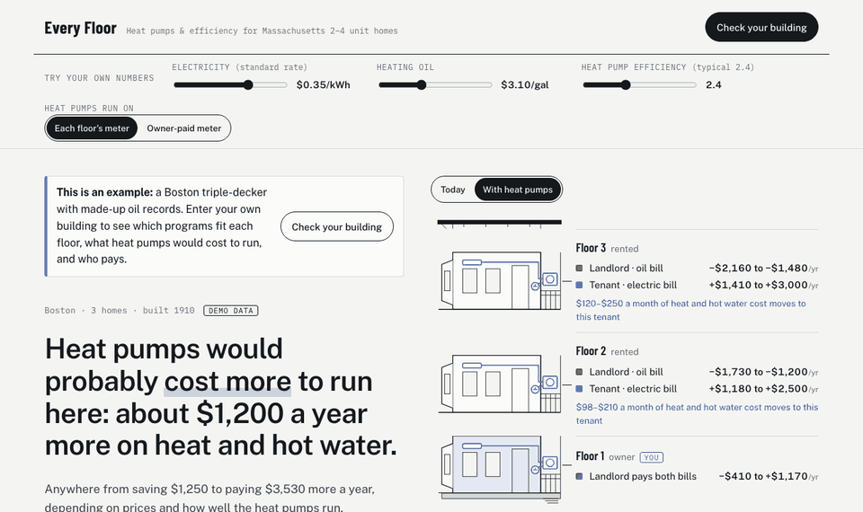
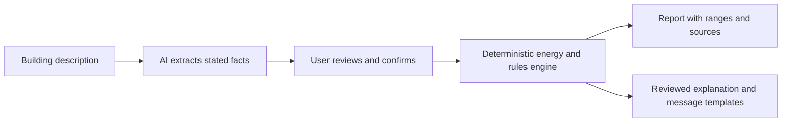

# Every Floor

Heat pumps and efficiency programs for Massachusetts triple-deckers and two-families. It shows which programs fit
each floor, what to do first, and who ends up paying more when a building switches.

[](https://github.com/Qiao527/ma-energy-navigator/actions/workflows/ci.yml)

**Try the energy demo:** https://qiao527.github.io/ma-energy-navigator/

The AI-enabled version is currently a login-protected preview; see [AI navigator](#ai-navigator).



*The building in the demo is made up, including its oil delivery records.*

An energy engineering portfolio project by Qiao Long (Boston College, Human-Centered Engineering).

---

## Why it exists

Massachusetts has generous heat pump and efficiency programs, and they're hard to use. If you own a three-unit
building, the rules change by unit, by who lives there, by income, by town and by install date. You often buy
the oil while your tenants pay the electric bill a heat pump would run on. MassCEC does offer human navigators
who walk owners through this, but only in a six-city pilot.

Households below 200% of the federal poverty level spend about 13% of their income on home energy. For everyone
else it's about 2% (DOE LEAD Tool, 2022 update).

The idea came from a hackathon brief on Massachusetts buildings: energy waste, retrofit priorities, and who gets
access to savings. The hackathon is over. This repository finishes the idea.

## What the page does

You describe the building: who lives on each floor, how it's heated, who pays which bill. Then the page shows:

1. The likely yearly change in running cost with heat pumps, as a range, next to the building drawn floor by
   floor with each bill and who pays it.
2. Why. One million Btu of heat costs a different amount from oil, gas, propane, baseboard and a heat pump, and
   there's an electricity price and an efficiency at which a heat pump breaks even.
3. Sliders for your own electricity price, fuel price and heat pump efficiency, and a switch for whether the
   heat pumps run on tenants' meters or an owner-paid one. Every number follows.
4. The heating cost that would move onto tenants' bills, the sanitary code rule that limits it (105 CMR 410),
   and four fair ways to handle it. It isn't legal advice.
5. The programs in the order to do them, what each one needs, and what only the program can confirm.
6. A map of Designated Equity Communities and the navigator pilot cities.
7. Every step of the math, with a source for every assumption.

## How the AI flow works



The model helps interpret a short description and chooses the focus and tone of a response. It does not calculate
savings or write program names and figures. Those come from the engine; explanations and coordination messages
are assembled from reviewed text. This is a constrained assistant, not an open-ended agent.

The [AI evaluation](eval/README.md) documents 16 fictional cases, including unknown facts, conflicting answers,
per-floor differences, out-of-scope buildings and an instruction-injection attempt. One expanded run initially
misclassified a single-family owner; after a prompt change, the same 16 cases passed once. This is a small,
developer-authored set, not a guarantee of model accuracy. Users confirm the form before calculations run.

## What it found

Here's the result I didn't expect when I started. At Massachusetts average prices for winter 2025–26, switching
the demo building's heat and hot water from oil to heat pumps lands anywhere from saving about $1,250 to paying
about $3,530 more a year. The typical case costs more, about $1,200.

The reason is simple once you see it. A million Btu of heat costs about $27 from an 84% efficient oil boiler.
From a heat pump at its field-measured efficiency (2.41), it costs about $34, even on Eversource's winter heat
pump rate, which averages $0.28/kWh over the season against $0.35 standard. Break-even is about $0.22/kWh, or an
efficiency of about 3.1.

The bigger story for a landlord is who pays. On each floor's own meter, $2,590 to $5,500 a year of energy cost
moves from the landlord's oil bill to the tenants' electric bills. The state's own energy office says it plainly:
households "should not assume that switching fuels will automatically lead to savings."


## The energy chain

| Step | How | Source |
|---|---|---|
| Fuel use | The user's delivery records, by heating season | User input |
| Weather normalization | Each season × normal ÷ actual heating degree days | NOAA CPC, Massachusetts population-weighted HDD |
| Hot water | When the boiler also heats water, the typical hot-water share is removed | NREL ResStock 2025.1, MA 2–4 unit homes (oil 18%, gas 21%) |
| Heat delivered | Fuel × heat content × boiler efficiency | EIA heat contents; EEAC baseline AFUE |
| No records | Typical heat load and heat pump size for similar buildings | ResStock, by fuel and vintage (25th / 50th / 75th percentile) |
| Heat pump electricity | Heat ÷ seasonal COP (1.90 / 2.41 / 2.80) | Cadmus cold-climate heat pump field study (MassCEC, NYSERDA, DOE) |
| Bills | Statewide prices for this winter and last | Massachusetts DOER, Household Heating Costs |
| Heat pump rate | Winter (Nov–Apr) delivery discount by electric company, weighted by the share of the heating season in those months | Eversource and National Grid tariffs; D.P.U. 26-71; NOAA CPC monthly HDD |
| Hot water switch | Oil for hot water out; a heat pump water heater's yearly electricity in | ResStock hot-water share; Efficiency Maine HPWH metering study (2026) |
| CO₂ | Fuel factors; New England grid factor | EPA Emission Factors Hub 2025 (eGRID NEWE) |
| Project cost | Tons × installed cost per ton | EEAC Residential Heat Pump Invoice Cost Study |
| Incentives | Each program's published rules, with verbatim quotes | Mass Save, mass.gov, DPU, M.G.L. |

All 51 assumptions and every rule are listed in the page, with links and the date each was checked.

## How the numbers stay honest

Every number on the page comes out of the engine in `engine/`, a tested TypeScript package. It works in low /
mid / high ranges and attaches a confidence label with its reasons. Nothing is typed into the page by hand.

Each rule and assumption carries the URL it came from, the section, a word-for-word quote and the date someone
checked it. `npm run rules:check-drafts` confirms every quote actually appears in a saved copy of the source
(`rules/ma/sources/`), so a misquote fails the build.

Nothing ships until the owner approves it. Approvals are stored in `rules/ma/approvals.json` against each file's
SHA-256, and the loader and the public build both refuse a file that changed afterward. The standard scenarios
(`npm run scenarios`) pin the engine's answers for fixed buildings and dates, and a changed answer needs approval
again.

When a fact is unknown, like who pays a bill or whether the boiler heats the water, the page asks. It doesn't
guess.

The full worked example, from delivery records to bills, CO₂ and who pays, is in [`docs/methods.md`](docs/methods.md).

Decisions and their reasons are logged in [`docs/decisions.md`](docs/decisions.md); the product definition is in
[`docs/product.md`](docs/product.md); the working rules are in [`CONTRIBUTING.md`](CONTRIBUTING.md).

## Repository

```
engine/     TypeScript rules engine and finance core (Zod, Vitest, fast-check)
rules/ma/   Approved rules and assumptions, source snapshots, approval ledger
scenarios/  Standard scenarios with expected results
web/        The page: a static build that runs the engine in the browser (esbuild)
ai/         Server-side model integration, validation and tests
eval/       Fictional model evaluation cases and reproducible runner
analysis/   Python (standard library) data scripts: ResStock estimates, town boundaries
data/       Shared Census municipality boundaries used by the engine and map
tools/      Source capture, draft report, approval
docs/       Product definition, decisions, research, plans
```

## Run it

Requires Node 24 and Python 3.

```bash
cd engine && npm ci && npm run check          # typecheck + all tests
npm run scenarios                             # standard scenarios
cd ../web && npm ci && npm run build          # web/dist/index.html (approved rules only)
cd .. && python3 -m pytest analysis tools     # data script tests
```

Open `web/dist/index.html` in a browser. Form calculations run in the browser. If you use the optional AI assistant, your description is sent to DeepSeek.

## AI navigator (local preview)

The optional assistant extracts explicitly stated facts from a description. Review and confirm those facts before
they replace the form. Unknown fields stay unknown. It can also choose the focus and tone of a short explanation
and a coordination message. Those texts use fixed, reviewed sentences and the current engine result: the model
cannot write the displayed amounts or program names. This is a constrained first version, not an open-ended chatbot.

The example report is available without an AI request. Live AI requires the visitor's own DeepSeek API key and is billed to their account. The key stays in the current page's password field until reload and is sent via HTTPS to the application server and forwarded to DeepSeek for each request. The app does not persist or log it. The GitHub Pages demo is static and cannot run the AI service.

To try the AI flow locally, build the page as above, then run:

```bash
node ai/server.mjs
```

Open `http://localhost:3000` and enter your key in the page. The local server requires Node 24 and does not log
requests. `DEEPSEEK_MODEL` optionally overrides the default DeepSeek model. Calls use the
[DeepSeek JSON output](https://api-docs.deepseek.com/guides/json_mode/).
Using the assistant sends the text you enter to DeepSeek; do not include names, street addresses, account numbers,
or utility bills. Normal form calculations stay in your browser. The local server is for local testing only, not
public deployment. The public backend uses a rate limit; that per-IP limit is not an account-wide spending cap.

Run `node --test ai/*.test.mjs` for service validation tests; the engine suite covers the confirmation and
rendering boundary and grounding across the standard scenarios. These tests use mocked model responses and cannot establish the model's extraction accuracy.

## Accessibility

The target is WCAG 2.2 AA:

- every chart has a table;
- color never carries meaning alone;
- all controls work by keyboard;
- motion stops under `prefers-reduced-motion`;
- the page works at phone width (checked at 360 px).

The Phase 1 release recorded automated axe-core scans with no violations in light or dark mode. The later AI
interface and current mobile and keyboard flows still need a fresh full accessibility audit.

## Data and credits

- **NREL ResStock 2025 Release 1.** Licensed CC BY 4.0: "End-Use Load Profiles for the U.S. Building Stock",
  National Renewable Energy Laboratory.
- **U.S. Census Bureau** cartographic boundaries; **NOAA** Climate Prediction Center degree days; **EPA**
  Emission Factors Hub; **EIA** heat contents. All are U.S. government works.
- **Program rules** are quoted from Mass Save, mass.gov (DOER, DPU, the 105 CMR 410 sanitary
  code) and the Massachusetts General Laws, with the link to each source.

Programs decide eligibility. This tool shows what their published rules say and names what to confirm.

## License

Code: [MIT](LICENSE), © 2026 Qiao Long. Data and quoted program text keep their own terms (see Data and credits):
ResStock is CC BY 4.0, and U.S. government works are in the public domain.

## Author

Qiao Long · [github.com/Qiao527](https://github.com/Qiao527)
